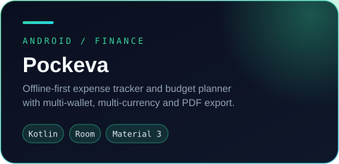
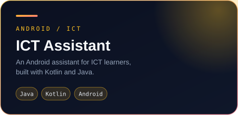

<div align="center">



<a href="https://github.com/itspabel">
  
</a>

<br/><br/>


</div>

<br/>

> [!NOTE]
> I believe great software is small, honest and fast. When plain PHP and vanilla JavaScript can do the job better, I skip the framework.

<br/>

## `about.php`

```php
<?php

final class Pabel
{
    public string $name     = 'Tasfiqul Alam Pabel';
    public string $handle   = 'itspabel';
    public string $location = 'Bangladesh';
    public string $role     = 'Full-Stack Web & Android Developer';

    public array $stack = [
        'backend'  => ['PHP', 'MySQL', 'REST APIs'],
        'frontend' => ['HTML5', 'CSS3', 'Vanilla JavaScript'],
        'mobile'   => ['Kotlin', 'Java', 'Android Room', 'Material Design 3'],
    ];

    public array $principles = [
        'Security first: CSRF, rate limiting, safe uploads',
        'Offline-first whenever it makes sense',
        'Bangla language support is a feature, not an afterthought',
        'Ship it, test it, then polish it',
    ];
}
```

<br/>

## Featured Work

<div align="center">






</div>

<details>
<summary><b>Pockeva - feature breakdown</b></summary>

<br/>

| Area | What it does |
| :-- | :-- |
| Wallets | Cash, banks, savings, bKash, Nagad, Rocket and Upay |
| Money | Multi-currency transactions and category budgets |
| Planning | Shopping list with reminders |
| Insight | Charts and PDF statement export |
| Data | Offline-first with Room database and JSON backup/restore |
| Design | Material Design 3 dark theme |

</details>

<details>
<summary><b>VaultShare - feature breakdown</b></summary>

<br/>

| Area | What it does |
| :-- | :-- |
| Uploads | Chunked uploads for large files |
| Sharing | Password-protected links and burn-after-reading |
| Protection | CSRF protection and rate limiting |
| Stack | PHP and MySQL, dark "Cold Storage Vault" theme |

</details>

<br/>

## Tech Arsenal

<div align="center">


</div>

<details>
<summary><b>Full toolbox</b></summary>

<br/>

| Layer | Tools |
| :-- | :-- |
| Backend | PHP 8, MySQL, PDO, REST endpoints |
| Frontend | Semantic HTML, modern CSS, Vanilla JS |
| Mobile | Kotlin, Java, Android Room, Material Design 3 |
| Security | CSRF tokens, rate limiting, content validation |
| Workflow | Git, GitHub, Android Studio, VS Code |

</details>

<br/>

## GitHub Pulse

<div align="center">


</div>

<br/>

## Let's Connect

<div align="center">

<a href="https://pabel.dev"></a>
<a href="https://github.com/itspabel"></a>

</div>

> [!TIP]
> Got an idea, a bug, or an ambitious project? Open an issue or start a discussion on any repository. I read everything.

<br/>

<div align="center">


</div>
